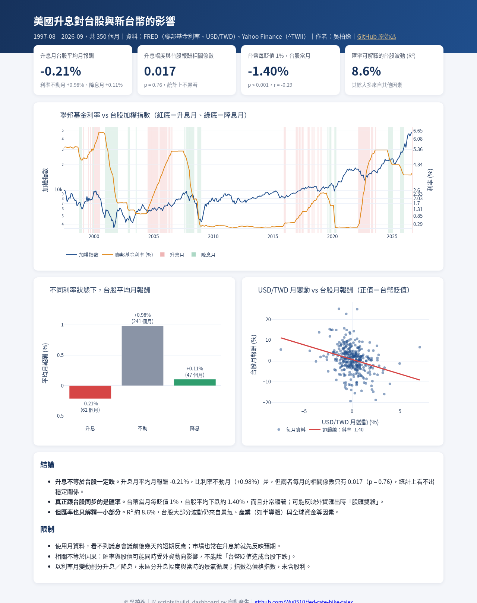
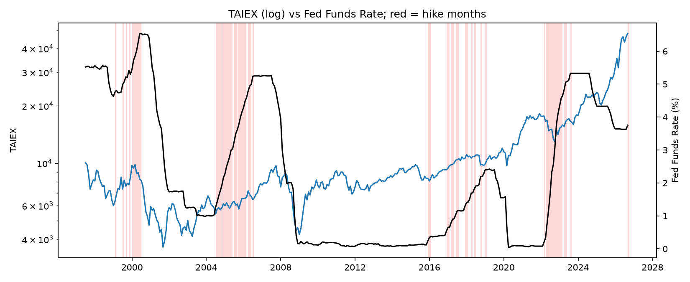
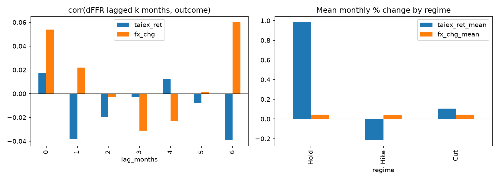

# 美國升息，台股與新台幣怎麼動？

## 🔗 互動儀表板

**線上版：https://wu0510.github.io/fed-rate-hike-taiex/**（由 `python scripts/build_dashboard.py` 產生 `docs/index.html`）



## 問題
Fed 升息時，台股報酬與新台幣匯率是否有系統性變化？理專面對客戶「要升息了，股票要不要減碼？」時，數據怎麼說？

## 資料來源
FRED（聯邦基金利率 FEDFUNDS、新台幣/美元 DEXTAUS、美國 CPI）＋ Yahoo Finance 台股加權指數 ^TWII。期間 1997-08 ~ 2026-09，共 350 個月。詳見 [data/SOURCES.md](data/SOURCES.md)。

## 方法
1. `sql/clean.sql`（DuckDB）：匯率日資料取月平均，四份資料統一成月資料並依月份合併 → `data/processed/monthly_merged.csv`
2. `notebooks/analysis.ipynb`（Pandas / statsmodels）：
   - 台股月報酬 %、匯率月變動 %（正值＝新台幣貶值）、利率月變動 dFFR
   - 月份分類：dFFR ≥ +0.10 → 升息；≤ −0.10 → 降息；其餘 → 不動
   - 相關係數、dFFR 落後 0–6 個月相關、各狀態平均報酬、OLS：`taiex_ret ~ dFFR + fx_chg`（HC1 穩健標準誤）

## 儀表板
Tableau Public：待補（資料：`outputs/tableau_monthly.csv`）




## 發現
1. **升息月份台股表現較弱**：升息月（62 個月）台股平均月報酬 −0.21%（中位數 +0.38%），利率不動月（241 個月）則是 +0.98%（中位數 +1.06%）。
2. **但利率變動本身幾乎無法預測台股**：dFFR 與當月台股報酬的相關係數只有 0.02，落後 1–6 個月也都介於 −0.04 ~ +0.01；OLS 中 dFFR 不顯著（p = 0.68）。升息期間表現較差，比較可能是跟景氣或其他因素一起發生，不是升息直接造成的。
3. **匯率才是台股的關鍵同步指標**：新台幣貶值 1%，台股當月平均少 1.41%（p < 0.001），相關係數 −0.29，符合「外資匯出＝股匯雙殺」的實務經驗。
4. **升息不必然讓新台幣貶值**：升息、降息、不動三種月份的匯率平均變動都在 +0.04% 左右，幾乎沒有差別。
5. **給理專的意涵**：與其看 Fed 升不升息，不如盯新台幣與外資動向；升息消息不能單獨當作減碼台股的理由。

## 限制
- 相關不等於因果；升息通常伴隨景氣過熱或通膨，有遺漏變數的問題。
- 月資料會稀釋利率決策當下的反應；dFFR 用的是有效利率月均值，不是 FOMC 會議當日的意外變動。
- 樣本 1997–2026 期間的升息循環只有幾次（2004–06、2015–18、2022–23），升息月份約 62 個，結論容易受單一循環影響。
- 指數為價格指數，未含股利。

## 下一步
- 改用 FOMC 會議日的日資料做事件研究，並加入台灣央行利率、外資買賣超
- 加入美國 10 年期公債殖利率與 CPI，區分「預期內」與「意外」升息
- 完成 Tableau Public 儀表板

## 重現
```bash
pip install duckdb pandas statsmodels matplotlib yfinance jupyter
jupyter nbconvert --to notebook --execute --inplace notebooks/analysis.ipynb
```
